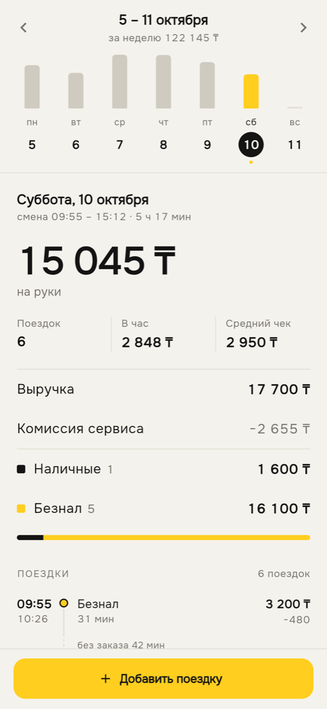
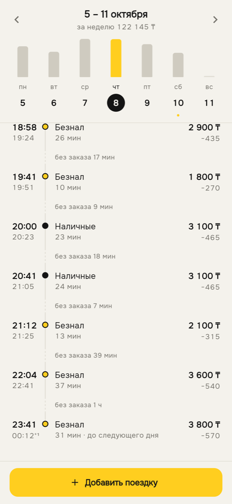
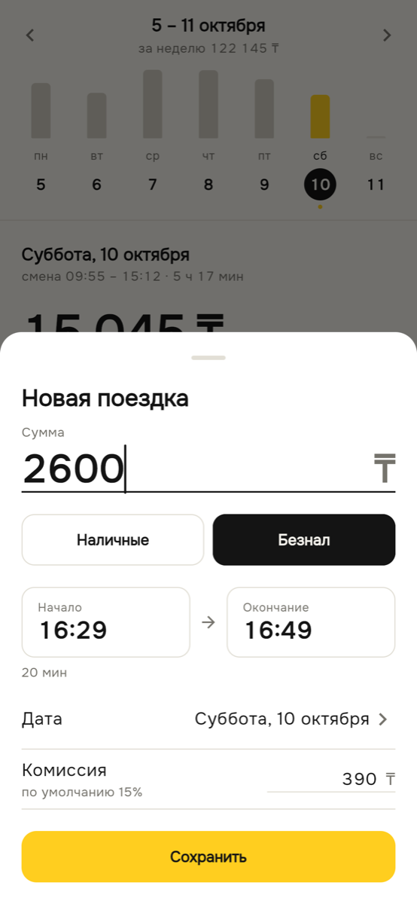
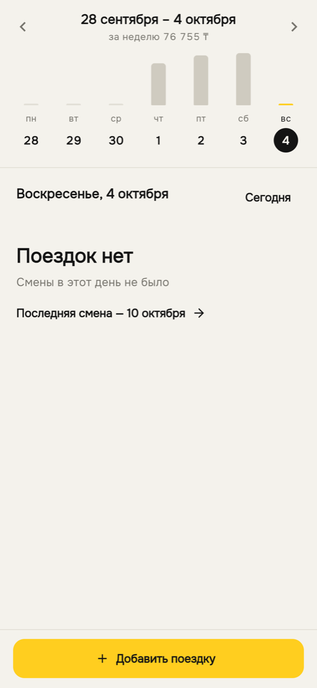
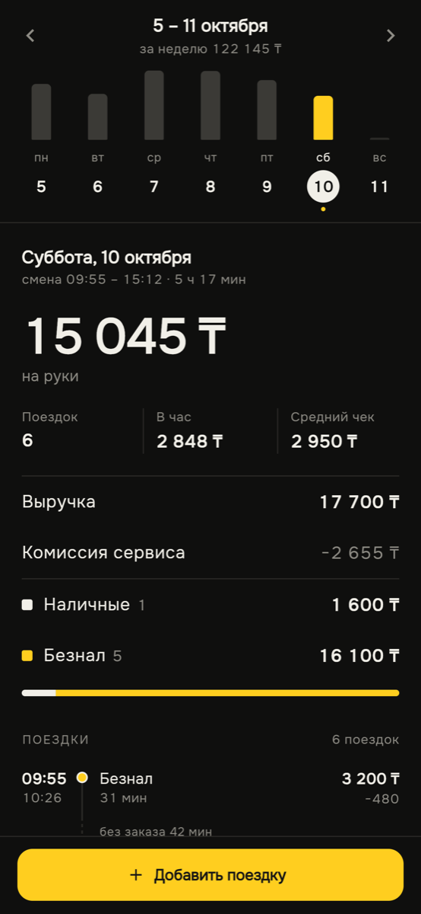

# Дневник смен водителя

Сервер на **Python (FastAPI)** и клиент на **Flutter** (web, Android, iOS, macOS). Обе части построены по принципам чистой архитектуры: клиент на **feature-first + bloc + freezed**, сервер — со слоями domain / application / infrastructure / api.

| День | Ночная смена | Новая поездка | Пустой день | Тёмная тема |
|---|---|---|---|---|
|  |  |  |  |  |

## Что сделано

- **API дня.** `GET /api/days/{date}` отдаёт сводку за день и список поездок. В сводке: число поездок, выручка, комиссия, «на руки», разбивка наличные/безнал. `GET /api/days` возвращает рабочие дни с суммой «на руки» за каждый; через `?from=&to=` можно ограничить период.
- **Клиент.** Неделя показана столбиками заработка. День выбирается нажатием на столбик, недели листаются стрелками или свайпом, есть календарь. Под неделей — итог дня и лента поездок с простоями между заказами.
- **Добавление поездки.** `POST /api/trips` проверяет данные и защищён от дублей (правила ниже). Форма подставляет время и комиссию сама и поддерживает поездки через полночь.
- **Тесты.** На сервере 113 тестов (pytest), на клиенте 37 (flutter test, bloc_test, mocktail). На обеих сторонах есть архитектурные тесты: они проверяют, что внутренние слои не импортируют внешние.

## Как запустить

Нужны Python 3.12+ и Flutter (проверено на Python 3.12/3.13 и Flutter 3.47.4).

```bash
make setup     # venv + pip install -e ".[dev]", flutter pub get
make backend   # сервер на http://127.0.0.1:8000, Swagger — /docs
make client    # клиент в Chrome
make test      # тесты сервера и клиента
make lint      # ruff, mypy --strict, flutter analyze
```

Без make:

```bash
cd backend && python3 -m venv .venv && .venv/bin/pip install -e ".[dev]"
.venv/bin/python -m driver_diary
```
```bash
cd client && flutter pub get && flutter run -d chrome
```

При первом запуске сервер копирует `data/seed_trips.json` (81 поездка за 1–10 октября 2026) в `data/trips.json` и дальше работает с этой копией. Чтобы вернуть исходные данные, выполните `make reset-data`.

Сгенерированные файлы `*.freezed.dart` и `*.g.dart` лежат в репозитории, поэтому для запуска кодогенерация не нужна. После изменения моделей выполните `make codegen`.

**Настройки сервера** (переменные окружения): `HOST`/`PORT` (по умолчанию `127.0.0.1:8000`; для телефона в той же сети — `HOST=0.0.0.0`), `DATA_FILE`, `SEED_FILE`, `DRIVER_UTC_OFFSET` (по умолчанию `+05:00`), `CORS_ORIGINS`, `RELOAD`.

**Адрес сервера в клиенте:** по умолчанию `http://127.0.0.1:8000`, в Android-эмуляторе — `http://10.0.2.2:8000`. Другой адрес задаётся флагом `flutter run --dart-define=API_URL=http://192.168.1.10:8000`.

## Дизайн

Цель была уйти от вида «шаблонного Material-приложения»: тональных карточек, круглых аватарок с иконками и FAB. Вместо этого экран сделан по образцу приложений, которыми водители пользуются каждый день:

- **Недельные столбики заработка**, как во вкладке Earnings у [Uber Driver](https://www.uber.com/us/en/newsroom/refining-the-earnings-experience-2/). Сразу видно, какой день был удачным, и в него можно провалиться нажатием.
- **«На руки» отдельно от выручки и комиссии сервиса**, как в разделе «Заработок» у Яндекс Про. Сводка оформлена как ведомость: строки «подпись — сумма» с тонкими разделителями.
- **Заработок в час и средний чек.** Это главные метрики в трекерах для водителей вроде [Gridwise](https://gridwise.io/features/earnings). «В час» считается по длительности смены — от начала первой поездки до конца последней.
- **Лента смены** с простоями между заказами («без заказа 42 мин»). Это информация, которая помогает водителю, а не украшение.
- **Широкая кнопка «Добавить поездку» внизу экрана**, до которой легко дотянуться одной рукой, когда телефон в держателе. В форме сумма набирается крупно, а наличные и безнал переключаются двумя большими кнопками.
- **Палитра «бумага + чернила»** с одним акцентом — такси-жёлтым, плюс тёмная тема. Шрифт Onest вместо Roboto. Суммы набраны цифрами одинаковой ширины (tabular figures), поэтому столбцы ровные.

## Архитектура

### Сервер (`backend/driver_diary`)

```
domain/          Trip (инварианты в __post_init__), summarize() — чистый Python, без фреймворков
application/     сценарии: GetDayReport, ListWorkDays, AddTrip, GetTrip; порты TripRepository и UnitOfWork
infrastructure/  JsonTripStore + JsonUnitOfWork (файл), InMemoryTripRepository
api/             FastAPI: схемы pydantic, маршруты, перевод ошибок домена в 422/409; create_app — корень композиции
```

Зависимости направлены только внутрь: `api → application → domain`, а `infrastructure` реализует порты application. Это правило проверяет тест `tests/unit/test_architecture.py`.

Pydantic в API проверяет только форму запроса: типы, обязательные поля и запрет лишних полей. Бизнес-правила (сумма > 0, окончание позже начала, комиссия не больше суммы) живут в доменной сущности `Trip`, а ошибки доменных проверок возвращаются как 422 в формате FastAPI.

Тесты разложены по слоям: `unit/domain`, `unit/application` (с фейковым UoW, без файлов и HTTP), `integration` (JSON-хранилище, атомарная запись, откат) и `api` (HTTP через TestClient). Настроены `ruff` и `mypy --strict`.

### Клиент (`client/lib`)

```
app/        DriverDiaryApp, AppDependencies — корень композиции (ручной DI через RepositoryProvider)
core/       сеть (ApiClient, guard → Failure), Result, время (ZonedDateTime), форматирование, тема
shared/     общая сущность Trip и её DTO
features/
  diary/        просмотр дня и недели
    domain/       DayReport, DaySummary, WorkDay; DiaryRepository; GetDayReport, GetWorkDays
    data/         DTO (freezed + json_serializable), remote data source, DiaryRepositoryImpl
    presentation/ DiaryBloc, DiaryPage, WeekStrip, EarningsSummary, TripTimeline
  trip_entry/   добавление поездки
    domain/       TripDraft (валидация, полночь, время по умолчанию), TripEntryOutcome; SubmitTrip
    data/         NewTripDto, разбор 201/200/409, TripEntryRepositoryImpl
    presentation/ TripEntryBloc, TripEntrySheet
```

- **Модели.** Сущности, DTO, события и состояния блоков описаны на `freezed`. Ошибки — sealed-класс `Failure`, а результат репозитория — `Result<T>` (`Ok` / `Err`). Исключения не выходят за пределы слоя data.
- **`DiaryBloc`** обрабатывает все события через `restartable()`. Если быстро листать дни, ответ на устаревший запрос отбрасывается.
- **`TripEntryBloc`** отправляет форму через `droppable()`, так что двойное нажатие не создаёт второй запрос. Ответы 201, 200 и 409 сервера — это три штатных исхода (`created` / `alreadySaved` / `conflict`), а не ошибки.
- **Время поездок** показывается в часовом поясе водителя (`ZonedDateTime`), а не телефона или браузера.
- **Проверка слоёв.** Тест `test/architecture_test.dart` следит, что domain не импортирует Flutter, сеть и внешние слои, а `diary` обращается к `trip_entry` только через её domain и экран формы.

## API

| Метод | Путь | |
|---|---|---|
| `GET` | `/api/days/{YYYY-MM-DD}` | сводка и поездки за день |
| `GET` | `/api/days?from=&to=` | рабочие дни: `{date, trips_count, net}` |
| `POST` | `/api/trips` | добавить поездку |
| `GET` | `/api/trips/{id}` | одна поездка |

```json
GET /api/days/2026-10-01
{
  "date": "2026-10-01",
  "utc_offset": "+05:00",
  "summary": {
    "trips_count": 9, "revenue": 25900, "commission": 3885, "net": 22015,
    "by_payment": {
      "cash": {"count": 5, "amount": 14500, "commission": 2175},
      "card": {"count": 4, "amount": 11400, "commission": 1710}
    }
  },
  "trips": [
    {"id": "t1", "start": "2026-10-01T08:10:00+05:00", "end": "2026-10-01T08:32:00+05:00",
     "amount": 2400, "payment": "card", "commission": 360}
  ]
}
```

| Ответ на `POST /api/trips` | Когда |
|---|---|
| `201 Created` | поездка сохранена |
| `200 OK` | такая поездка уже сохранена; в ответе возвращается она, дубль не создаётся |
| `409 Conflict` | `{"detail": {"code": "id_conflict" \| "trip_overlap", "message", "existing": {…}}}` |
| `422` | `{"detail": [{"loc": ["body", "<поле>"], "msg": "…"}]}` |

## Правила и решения

**К какому дню относится поездка.** По дате *начала* в часовом поясе водителя (`DRIVER_UTC_OFFSET`, по умолчанию UTC+5). Поездка 23:41–00:12 попадает в день, когда началась (в демо-данных такая есть 8 октября). Время, присланное в другом поясе (`…Z`), сервер переводит в пояс водителя.

**«На руки»** = выручка − комиссия. Суммы хранятся как целые тенге: без float и ошибок округления.

**Проверка данных (422):**
- `amount > 0`;
- `end > start`;
- `0 ≤ commission ≤ amount`;
- `payment` — `cash` или `card`;
- у времени обязательно указан часовой пояс;
- суммы должны быть строго целыми числами;
- лишние поля отклоняются.

**Защита от дублей:**
1. `id` поездки служит ключом идемпотентности. Клиент создаёт его вместе с черновиком и при повторной отправке (например, после сетевой ошибки) шлёт тот же id. Если данные совпадают, сервер отвечает `200` с сохранённой поездкой. Если данные другие, возвращается `409 id_conflict`.
2. Та же поездка без id или под другим id тоже считается повтором: сервер отвечает `200`. Время сравнивается как момент, поэтому `08:10+05:00` и `03:10Z` — одно и то же.
3. Поездка, пересекающаяся по времени с сохранённой, отклоняется с `409 trip_overlap`. Водитель не может везти два заказа одновременно, а без этой проверки «почти дубль» (та же поездка с исправленной суммой) сохранился бы как новая запись. Поездки встык разрешены.
4. Проверка и вставка выполняются в одном `UnitOfWork` под блокировкой, поэтому 32 параллельных повтора создают ровно одну запись (на это есть тест). Файл пишется атомарно (временный файл + `os.replace`). Если запись упала, не меняется ни файл, ни данные в памяти.

## Ограничения и что можно улучшить

- Хранилище — JSON-файл с блокировкой в памяти, поэтому сервер нужно запускать в одном процессе. Если процессов будет несколько, понадобится `UnitOfWork` на SQLite или Postgres. Сценарии и домен при этом не меняются, это и есть смысл портов.
- Часовой пояс задан фиксированным смещением. Для регионов с переходом на летнее время понадобится IANA-зона.
- Нет редактирования и удаления поездок, авторизации и поддержки нескольких водителей.
- Клиент мог бы копить поездки офлайн и отправлять их позже. Повторная отправка уже безопасна благодаря id.
- Шрифт Onest подгружается через `google_fonts`. Без интернета используется системный шрифт, а в веб-сборке знак ₸ может не отобразиться.
