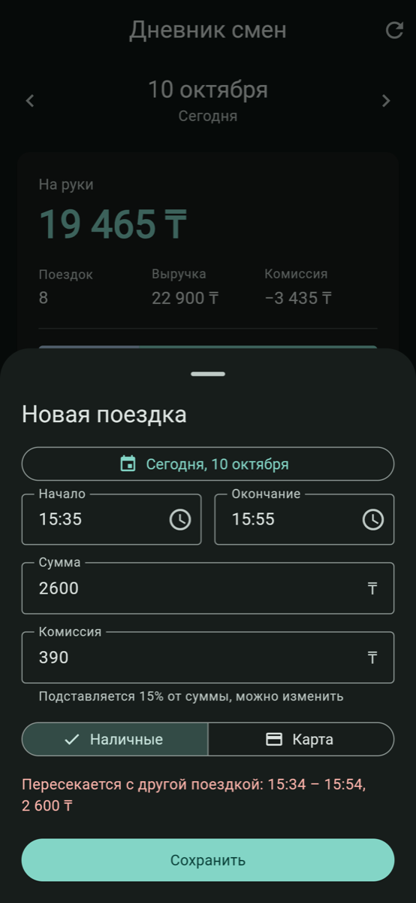

# Дневник смен водителя

Сервер на **Python (FastAPI)** и клиент на **Flutter** (web, Android, iOS, macOS). Приложение показывает сводку по выбранному дню и список поездок, даёт переключать дни и добавлять поездки. На сервере данные проверяются, а повторная отправка той же поездки не создаёт дубль.

| День | Новая поездка | После сохранения | Пустой день |
|---|---|---|---|
|  |  |  |  |

## Что сделано

- **API дня.** `GET /api/days/{date}` отдаёт сводку за день (число поездок, выручка, комиссия, «на руки», разбивка наличные/карта) и список поездок за этот день.
- **Клиент.** Показывает сводку и поездки. Дни переключаются стрелками, свайпом или через календарь. Если в выбранный день поездок нет, клиент предлагает перейти к последнему дню, когда они были.
- **Добавление поездки.** `POST /api/trips` проверяет данные и защищён от дублей (подробности ниже). В форме клиента комиссия подставляется автоматически (15%, как в исходных данных). Поездка через полночь тоже поддерживается.
- **Тесты.** 39 тестов сервера (pytest): расчёт сводки, границы дня, дубли, в том числе при параллельных запросах и после перезапуска, валидация. 18 тестов клиента (flutter test): разбор JSON, работа с часовым поясом, API-клиент, виджеты.

## Как запустить

Нужны Python 3.12+ и Flutter (проверено на Python 3.12/3.13 и Flutter 3.47.4).

### Сервер

```bash
cd backend
python3 -m venv .venv
source .venv/bin/activate
pip install -r requirements-dev.txt
python -m app
```

Сервер поднимается на `http://127.0.0.1:8000`, Swagger UI доступен на `http://127.0.0.1:8000/docs`.

При первом запуске `data/seed_trips.json` (81 поездка за 1–10 октября 2026) копируется в `data/trips.json`, и дальше сервер работает с этой копией. Чтобы вернуть исходные данные, удалите `data/trips.json` (или выполните `make reset-data`).

Настройки задаются переменными окружения:

| Переменная | По умолчанию | |
|---|---|---|
| `HOST`, `PORT` | `127.0.0.1`, `8000` | для телефона в той же сети: `HOST=0.0.0.0` |
| `DATA_FILE` | `backend/data/trips.json` | рабочий файл с поездками |
| `SEED_FILE` | `backend/data/seed_trips.json` | откуда взять данные, если `DATA_FILE` ещё нет |
| `DRIVER_UTC_OFFSET` | `+05:00` | часовой пояс водителя |
| `CORS_ORIGINS` | `*` | |
| `RELOAD` | `1` | автоперезапуск при изменении кода |

### Клиент

```bash
cd client
flutter pub get
flutter run -d chrome
```

Клиент по умолчанию обращается к `http://127.0.0.1:8000`, а в Android-эмуляторе — к `http://10.0.2.2:8000`. Другой адрес можно задать так: `flutter run --dart-define=API_URL=http://192.168.1.10:8000`.

### Тесты

```bash
cd backend && .venv/bin/pytest
cd client && flutter test
```

Есть и `Makefile`: `make setup`, `make backend`, `make client`, `make test`.

## API

| Метод | Путь | |
|---|---|---|
| `GET` | `/api/days/{YYYY-MM-DD}` | сводка и поездки за день |
| `GET` | `/api/days` | дни, в которые были поездки, и их число |
| `POST` | `/api/trips` | добавить поездку |
| `GET` | `/api/trips/{id}` | одна поездка |

```http
GET /api/days/2026-10-01
```
```json
{
  "date": "2026-10-01",
  "utc_offset": "+05:00",
  "summary": {
    "trips_count": 9, "revenue": 25900, "commission": 3885, "net": 22015,
    "by_payment": {
      "cash": {"count": 5, "amount": 14500, "commission": 2175},
      "card": {"count": 4, "amount": 11400, "commission": 1710}
    }
  },
  "trips": [
    {"id": "t1", "start": "2026-10-01T08:10:00+05:00", "end": "2026-10-01T08:32:00+05:00",
     "amount": 2400, "payment": "card", "commission": 360},
    "…"
  ]
}
```

```bash
curl -X POST http://127.0.0.1:8000/api/trips -H 'Content-Type: application/json' -d '{
  "id": "7d1c...", "start": "2026-10-10T18:00:00+05:00", "end": "2026-10-10T18:25:00+05:00",
  "amount": 2600, "payment": "cash", "commission": 390}'
```

| Ответ | Когда |
|---|---|
| `201 Created` | поездка сохранена |
| `200 OK` | такая поездка уже сохранена; в ответе возвращается она, новая запись не создаётся |
| `409 Conflict` | `{"detail": {"code": "id_conflict" \| "trip_overlap", "message": ..., "existing": {поездка}}}` |
| `422` | данные не прошли проверку |

## Правила и решения

**К какому дню относится поездка.** По дате *начала* в часовом поясе водителя (`DRIVER_UTC_OFFSET`, по умолчанию UTC+5, как в примере данных). Поездка 23:41–00:12 попадает в день, когда началась (в демо-данных такая есть 8 октября). Время, присланное в другом поясе (например, `…Z`), сервер переводит в пояс водителя: `19:30Z` 1 октября относится к 2 октября. Сервер отдаёт время в поясе водителя, и клиент показывает его именно так, а не по часовому поясу телефона или браузера.

**«На руки»** = выручка − комиссия. Разбивка наличные/карта содержит число поездок, сумму и комиссию по каждому способу оплаты. Суммы хранятся как целые тенге без float, поэтому ошибок округления нет.

**Проверка данных (422):** `amount > 0`, `end > start`, `0 ≤ commission ≤ amount`, `payment` — одно из `cash`/`card`, у времени обязательно указан часовой пояс. Суммы должны быть именно целыми числами: `"2400"` и `2400.5` не принимаются. Неизвестные поля отклоняются.

**Защита от дублей:**
1. `id` поездки служит ключом идемпотентности. Клиент генерирует UUID, когда открывается форма, и при повторных нажатиях «Сохранить» (например, после сетевой ошибки) отправляет тот же id. Если поездка с таким id уже сохранена и данные совпадают, сервер возвращает `200` с ней. Если данные другие, возвращается `409 id_conflict`.
2. Если та же поездка (то же время, сумма, оплата и комиссия) приходит без id или под другим id, это тоже повтор: сервер отвечает `200` и возвращает уже сохранённую запись. Время сравнивается как момент, поэтому `08:10+05:00` и `03:10Z` считаются одним и тем же временем.
3. Поездка, пересекающаяся по времени с уже сохранённой, отклоняется с `409 trip_overlap`. Водитель не может везти два заказа одновременно, а без этой проверки «почти дубль» (та же поездка с исправленной суммой) сохранился бы как новая запись. Поездки встык (одна кончилась в 08:32, следующая началась в 08:32) разрешены.
4. Проверка и вставка выполняются под одной блокировкой, поэтому параллельные повторы не создают дубль (на это есть тест). Файл перезаписывается атомарно, через временный файл и `os.replace`, так что после перезапуска сервер видит те же поездки и защита от дублей продолжает работать.

## Структура

```
backend/
  app/models.py      модели и валидация (Pydantic)
  app/summary.py     расчёт сводки — чистая функция
  app/storage.py     хранилище в JSON-файле, дедупликация, границы дня
  app/main.py        маршруты FastAPI
  data/seed_trips.json
  tests/             test_summary.py, test_trips.py
client/
  lib/src/models.dart          модели, время в поясе водителя (ZonedDateTime)
  lib/src/api.dart             HTTP-клиент, ошибки 409/422/сеть
  lib/src/diary_controller.dart  состояние экрана (ChangeNotifier)
  lib/src/diary_screen.dart    экран дня
  lib/src/summary_card.dart, trip_list.dart, add_trip_sheet.dart
  test/
```

## Ограничения и что можно улучшить

- Хранилище — JSON-файл с блокировкой в памяти, поэтому сервер нужно запускать в одном процессе. Если процессов будет несколько, понадобится SQLite или Postgres с уникальными индексами и проверкой пересечений в транзакции.
- Часовой пояс задан фиксированным смещением. Для регионов с переходом на летнее время понадобится IANA-зона.
- Нет редактирования и удаления поездок, авторизации и поддержки нескольких водителей.
- Клиент мог бы копить поездки офлайн и отправлять их потом. Повторная отправка уже безопасна благодаря id.
- В веб-сборке знак ₸ рисуется fallback-шрифтом, который Flutter подгружает из Google Fonts. Без доступа к интернету вместо знака может появиться квадрат. На Android, iOS и macOS используются системные шрифты.
